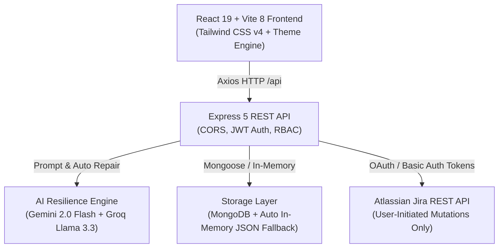

<div align="center">

# 🧪 AI QA Assistant

**The Ultimate AI-Powered Quality Assurance Platform for Modern Engineering Teams**

*Generate comprehensive test suites, produce standardized bug reports, track Jira worklogs with AI summaries, and monitor Jira ticket lifecycles in real time.*

[](LICENSE)
[](https://nodejs.org/)
[](https://react.dev/)
[](https://vitejs.dev/)
[](https://expressjs.com/)
[](https://tailwindcss.com/)
[](https://aistudio.google.com/)
[](https://groq.com/)
[](CONTRIBUTING.md)

[🚀 Live Demo](https://ai-qa-assistant-ueec.onrender.com/) • [📖 Documentation](#-table-of-contents) • [🛠 Quickstart](#-quickstart-guide) • [🤝 Contributing](CONTRIBUTING.md)

</div>

---

## 📖 Table of Contents

- [Overview](#-overview)
- [Key Features](#-key-features)
- [Architecture & Tech Stack](#-architecture--tech-stack)
- [Multi-LLM Resilience System](#-multi-llm-resilience-system)
- [Quickstart Guide](#-quickstart-guide)
- [Environment Configuration](#-environment-configuration)
- [Project Scripts](#-project-scripts)
- [Jira Security & Safety Policy](#-jira-security--safety-policy)
- [Project Directory Structure](#-project-directory-structure)
- [Roadmap](#-roadmap)
- [Contributing](#-contributing)
- [Security](#-security)
- [License](#-license)

---

## 🌟 Overview

Writing detailed test plans, edge cases, reproducible bug reports, and daily Jira worklogs takes up hours of an engineering team's week. **AI QA Assistant** is built to eliminate that friction:

1. **Paste any requirement, user story, or log output** — Get structured Positive, Negative, Edge Case, and Security test scenarios in seconds.
2. **AI Bug Report Generator** — Automatically formats raw incident notes into clean, Jira/GitHub-ready bug reports with environment details, reproduction steps, and severity levels.
3. **Jira Worklog & Time Tracking Engine** — Summarizes ticket activity into formatted Jira comments and allows single or batch CSV time-logging directly to Jira.
4. **Persistent Jira Watchlist & Alerts** — Automatically tracks watched tickets and notifies testers the moment a ticket moves into QA-ready states.
5. **Zero-Config In-Memory Fallback** — Run the entire stack instantly without installing or configuring a database!

---

## ✨ Key Features

| Feature | Description |
|---|---|
| 🧪 **AI Test Case Generator** | Generates structured test scenarios categorized into **Positive**, **Negative**, **Edge Cases**, and **Security Audits**, complete with step-by-step instructions and expected results. |
| 🐞 **AI Bug Report Generator** | Turns unstructured incident logs into standard bug tickets with reproduction steps, severity tags, and 1-click clipboard / sheet export. |
| ⏱️ **Jira AI Worklog Engine** | Analyzes Jira comments authored by your account, generates clear bulleted work summaries, and logs work time (`POST /rest/api/3/issue/{id}/worklog`). |
| 📁 **Batch CSV Worklog Upload** | Drag-and-drop CSV parser supporting auto-normalized headers (`Date`, `Ticket ID`, `Hours`, `Time Spent`), live batch table editing, and bulk Jira posting. |
| 🔔 **Jira Watchlist & Live Alerts** | Background polling engine monitors Jira tickets and fires real-time status change notifications in the navbar and dedicated alerts page. |
| 📊 **Enterprise QA Matrix Templates** | Built-in report templates: IEEE 829 Standard Test Plan, OWASP Security Matrix, Mozilla Bugzilla, and enterprise styled Excel layouts with customizable columns. |
| 👥 **Role-Based Access Control (RBAC)** | User registration, password hashing (`bcryptjs`), JWT sessions, and owner/admin auto-provisioning with user management controls. |
| 💾 **Guest Mode Session Engine** | Unauthenticated visitors can test the full platform immediately via browser `sessionStorage`, with automatic data isolation. |
| 🎨 **Dynamic Multi-Theme Engine** | Switch smoothly between **Dark Glassmorphism**, **Cyberpunk Neon**, **Light Mode**, and **Midnight Blue**. |
| 📥 **Export to Excel & CSV** | Export test cases, bug reports, and worklogs to formatted `.xlsx` spreadsheets or `.csv` files using SheetJS. |

---

## 🏗 Architecture & Tech Stack



- **Frontend**: React 19, Vite 8, React Router v7, Tailwind CSS v4, SheetJS (`xlsx`, `xlsx-js-style`), Axios
- **Backend**: Express.js 5, JSON Web Tokens (`jsonwebtoken`), `bcryptjs`, `dotenv`, `cors`
- **AI Models**: Google Gemini 2.0 Flash (`@google/generative-ai`), Groq Llama 3.3 70B (`groq-sdk`)
- **Database**: Mongoose (MongoDB) + Built-in In-Memory / Local JSON Disk Fallback Engine
- **Deployment**: Render Cloud single-service distribution (Serving Vite build via Express)

---

## 🤖 Multi-LLM Resilience System

AI QA Assistant includes a production-grade resilience layer:

- **Free-Tier Optimized**: Works with 100% free API keys from Google AI Studio and Groq Console (no credit card needed).
- **Automated Failover**: If Gemini encounters rate limits (HTTP 429) or transient outages, requests automatically fall over to Groq (Llama 3.3 70B) seamlessly.
- **Truncated Completion Repair**: Contains a built-in JSON regex tokenizer and structural repair parser in `promptBuilder.js` that salvages and recovers truncated AI responses without crashing the frontend.

---

## 🚀 Quickstart Guide

### 1. Prerequisites
- **Node.js**: `v18.0.0` or higher
- **npm**: `v9.0.0` or higher
- At least **one free AI API key**:
  - [Google AI Studio (Gemini)](https://aistudio.google.com/) *(Recommended)*
  - [Groq Console](https://console.groq.com/)

### 2. Clone the Repository
```bash
git clone https://github.com/Pratikshimpi48/AI-QA-Assistant.git
cd AI-QA-Assistant
```

### 3. Install All Dependencies
One command installs root, client, and server dependencies:
```bash
npm run install:all
```

### 4. Setup Environment Variables
Copy the template into `server/.env`:
```bash
cp .env.example server/.env
```
Open `server/.env` and paste your Gemini or Groq API key:
```env
PORT=5000
NODE_ENV=development
CLIENT_URL=http://localhost:3000
JWT_SECRET=super_secret_jwt_key_ai_qa_assistant_2026
ADMIN_EMAIL=admin@example.com

# At least one AI key required:
GEMINI_API_KEY=your_gemini_api_key_here
GROQ_API_KEY=your_groq_api_key_here
```

> **Note on MongoDB**: Setting `MONGO_URI` is completely optional! If omitted, AI QA Assistant runs on its built-in fast In-Memory fallback store with persistent local JSON recovery.

### 5. Launch Development Server
```bash
npm run dev
```
Open your browser at **[http://localhost:3000](http://localhost:3000)**. The Vite frontend proxy automatically forwards all `/api` requests to Express on port `5000`.

---

## ⚙️ Environment Configuration

| Variable | Required | Default | Description |
|---|---|---|---|
| `PORT` | No | `5000` | Port for the Express backend server. |
| `NODE_ENV` | No | `development` | Environment mode (`development` or `production`). |
| `CLIENT_URL` | No | `http://localhost:3000` | Allowed client origin for CORS. |
| `JWT_SECRET` | **Yes** | Built-in fallback | Secret string used to sign and verify user JWT sessions. |
| `ADMIN_EMAIL` | No | `pratikshimpi48@gmail.com` | Email address automatically granted Owner / Admin privileges upon registration or login. |
| `GEMINI_API_KEY` | Recommended | — | Google Gemini API key (Free tier: 15 RPM, 1500 RPD). |
| `GROQ_API_KEY` | Recommended | — | Groq API key (Free tier: 30 RPM, 1000 RPD). |
| `MONGO_URI` | No | In-memory fallback | MongoDB connection string. If omitted, uses local JSON/In-memory store. |
| `JIRA_POLL_INTERVAL_MS`| No | `300000` (5 min) | Background polling rate for Jira watchlist lifecycle alerts. |
| `JIRA_READY_STATUSES` | No | `Ready for QA,In QA,Done,Resolved,Merged` | Comma-delimited list of Jira statuses that trigger QA notifications. |

---

## 💻 Project Scripts

Run these scripts from the repository root:

- `npm run dev`: Runs both client (`:3000`) and server (`:5000`) concurrently.
- `npm run dev:client`: Runs only the Vite client dev server with HMR.
- `npm run dev:server`: Runs only the Express backend with `nodemon` auto-reload.
- `npm run install:all`: Installs dependencies for root, client, and server.
- `npm run lint`: Runs ESLint across the frontend codebase.
- `npm run build`: Production build script (builds client, installs server, copies static files).
- `npm run build:client`: Compiles the Vite frontend to `client/dist`.
- `npm run start`: Starts the production Express server.
- `npm run db:view`: Inspects the contents of the local fallback JSON store.

---

## 🛑 Jira Security & Safety Policy

AI QA Assistant was designed with **strict enterprise safety constraints**:

1. **NO Automated AI Jira Mutations**: AI subagents, prompt completion tasks, and background pollers **NEVER** issue `POST`, `PUT`, `PATCH`, or `DELETE` requests to your Jira instance.
2. **Explicit User-Initiated Actions**: Jira comment posting, work log creation, and deletions occur **only** when a user explicitly clicks the action button on the frontend.
3. **Strict Account ID Isolation**: When managing or deleting Jira comments, the application filters and deletes comments **only** authored by the connected Jira user account ID (`jiraEmail`). Other team members' comments are untouched.
4. **Token Security**: Jira credentials entered in the Settings page are stored encrypted or in user-isolated records, and never committed to version control.

---

## 📁 Project Directory Structure

```
AI-QA-Assistant/
├── .github/
│   ├── ISSUE_TEMPLATE/
│   │   ├── bug_report.md          # Standard bug report template
│   │   ├── feature_request.md     # Feature suggestion template
│   │   └── config.yml             # Issue configuration & links
│   ├── workflows/
│   │   └── ci.yml                 # Automated CI build and lint pipeline
│   └── pull_request_template.md   # Pull request review checklist
├── client/                        # React 19 Frontend
│   ├── src/
│   │   ├── components/            # Reusable UI components & Navbar
│   │   ├── context/               # Auth, Theme, & Notification state
│   │   ├── pages/                 # Full-page application views
│   │   ├── services/              # API clients (api.js)
│   │   └── utils/                 # Export utilities & Guest session
│   ├── eslint.config.js           # ESLint configuration
│   └── vite.config.js             # Vite 8 config with proxy
├── server/                        # Express 5 Backend
│   ├── src/
│   │   ├── config/                # env.js & db.js (Mongo + In-memory hybrid)
│   │   ├── middleware/            # JWT authentication & Admin RBAC
│   │   ├── models/                # User, History, Template models
│   │   ├── routes/                # Auth, Generate, BugReport, Jira, Admin
│   │   └── services/              # Gemini, Groq, promptBuilder, JiraPoller
│   ├── .env.example               # Backend environment template
│   └── package.json
├── scripts/                       # Deployment helper scripts (copy-dist.js)
├── .env.example                   # Top-level environment template
├── .gitignore                     # Airtight git ignore rules
├── CODE_OF_CONDUCT.md             # Contributor Covenant v2.1
├── CONTRIBUTING.md                # Contributor setup guide & rules
├── LICENSE                        # MIT License
├── PROJECT_STATUS.md              # Feature completion roadmap & status
└── README.md                      # Main project documentation
```

---

## 🗺️ Roadmap

- [x] Multi-LLM provider resilience (Gemini 2.0 Flash + Groq Llama 3.3 70B)
- [x] Dual-mode Jira Worklog Tracker (Single Ticket AI + Batch CSV Upload)
- [x] Persistent Jira Watchlist & Lifecycle Polling
- [x] Dynamic Theme Engine (Dark, Light, Neon, Midnight)
- [x] Admin Role Management & Enterprise Matrix Templates
- [x] In-Memory / JSON Fallback for zero-config local development
- [ ] **Test Automation Script Generation** (Playwright, Cypress, Selenium code export)
- [ ] **GitHub Issues & Azure DevOps Integration**
- [ ] **BDD / Gherkin Feature File Generator**
- [ ] **Local Ollama Model Support** (for fully offline air-gapped environments)

---

## 🤝 Contributing

We love contributions! Please read our [Contributing Guide](CONTRIBUTING.md) to learn how to clone, setup, test, and submit pull requests.

Please also review our [Code of Conduct](CODE_OF_CONDUCT.md).

---

## 🛡️ Security

If you discover a security vulnerability, please review our [Security Policy](SECURITY.md) and report it privately to **pratikshimpi48@gmail.com** instead of opening a public issue.

---

## 📄 License

This project is licensed under the [MIT License](LICENSE) &copy; 2026 **Pratik Shimpi**.
